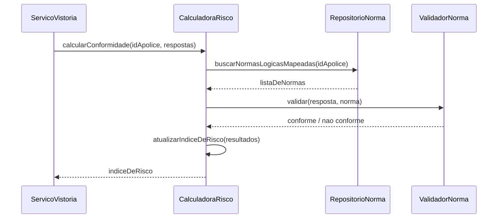

# ADR-001: Strategy para a validação das respostas do checklist por tipo de norma

- **Status:** aceita
- **Data:** 30/09/2026
- **Checkpoint:** CP 2 – Design Patterns
- **Autores:** Julia Yamazaki, Guilherme Blanco, Roberto Flaquer, Bryan de Almeida, Cauã Ceolin

## Contexto

O Risk Solutions gera um checklist dinâmico a partir das normas da apólice vigente da fábrica. Quando o vistoriador envia as respostas, a `CalculadoraRisco` compara cada resposta com a norma correspondente e atualiza o índice de risco da unidade (diagrama `images/diagrama_sequencia_validacao_normas.png`, mensagens 4 a 7).

O documento de visão do negócio parte da premissa de que as normas da seguradora são "mapeáveis em formatos lógicos (sim/não, valores, datas)". Cada formato é avaliado de um jeito:

| Tipo da norma | Quando a resposta está conforme |
|---|---|
| `SIM_NAO` | a resposta é o valor esperado pela norma |
| `LIMITE` | o valor informado está dentro do limite definido na norma |
| `DATA` | a data informada não está vencida |

Sem nenhum padrão, essa decisão vira um `switch` sobre `norma.tipo` dentro da `CalculadoraRisco`. É o maior condicional do projeto, porque cada tipo novo de norma mexe exatamente na função que define se a fábrica está em conformidade e, portanto, se a cobertura da seguradora vale. O Risco 2 do documento de visão (mudanças abruptas nas regras de compliance da seguradora) aponta que esse é o ponto que mais tende a mudar.

O projeto ainda não tem código. Este condicional é, então, o que a implementação produziria por padrão, e não um `switch` que já existe e precisa ser refatorado.

## Decisão

Aplicar **Strategy** na validação de normas.

- Uma interface `ValidadorNorma` com um método `validar(resposta, norma)`, que devolve se a resposta está conforme.
- Uma implementação por tipo de norma: `ValidadorSimNao`, `ValidadorLimite` e `ValidadorData`.
- A `CalculadoraRisco` mantém um mapa de tipo para validador e chama `validar` sem saber qual regra está sendo aplicada.
- Se aparecer um tipo de norma sem validador cadastrado, o cálculo falha com erro explícito. Não há validador padrão: tratar uma norma desconhecida como conforme (ou como não conforme) distorceria o índice de risco sem ninguém perceber.

Esboço em JavaScript (o backend é Node.js):

```js
class ValidadorSimNao {
  validar(resposta, norma) { return resposta === norma.valorEsperado; }
}

class ValidadorLimite {
  validar(resposta, norma) { return resposta >= norma.minimo && resposta <= norma.maximo; }
}

class ValidadorData {
  validar(resposta, norma) { return new Date(resposta) >= new Date(); }
}

class CalculadoraRisco {
  constructor(validadores) {
    this.validadores = validadores; // { SIM_NAO: ..., LIMITE: ..., DATA: ... }
  }

  validarResposta(resposta, norma) {
    const validador = this.validadores[norma.tipo];
    if (!validador) throw new Error(`Tipo de norma sem validador: ${norma.tipo}`);
    return validador.validar(resposta, norma);
  }
}
```

Como fica o mesmo cenário depois da decisão:



`V` é `ValidadorSimNao`, `ValidadorLimite` ou `ValidadorData`, conforme o tipo da norma.

## Alternativas consideradas

**Nenhum ainda.** Foi a decisão registrada no CP 2, com o argumento de que o diagrama da época não expunha ramificações por tipo. Revisamos porque o diagrama atual passa pelo condicional e porque a premissa das normas lógicas e o Risco 2 indicam que os tipos vão crescer. Continua sendo uma opção razoável se o sistema ficar com exatamente esses três tipos.

**Factory Method.** Resolve quem cria o validador, mas não tira a variação do comportamento: o `switch` só mudaria de lugar. Um mapa simples já faz a seleção. Vale reconsiderar se os validadores passarem a precisar de dependências na criação (por exemplo, configuração vinda do banco).

**Observer.** O problema aqui não é avisar interessados sobre uma mudança. Pode fazer sentido mais adiante para os alertas de não conformidade e de vencimento (caso de uso "Emitir Alertas"), mas isso é outra decisão.

**Adapter.** Não há API externa envolvida: as apólices são dados simulados no banco (seção Dependências do documento de visão).

**Decorator.** Não há comportamento opcional a empilhar sobre a validação. A rastreabilidade exigida (log de rotas, usuário, data e IP) é um requisito da API, não da regra de validação.

## Consequências

**Melhora**
- Um tipo novo de norma passa a ser uma classe nova, sem editar a lógica que calcula o risco.
- Cada validador pode ser testado isolado, com poucos casos.
- A `CalculadoraRisco` deixa de conhecer o formato das normas.
- Combina com a mitigação do Risco 2: regras parametrizáveis quando a seguradora mudar os critérios.

**Piora**
- Mais arquivos e uma interface para manter, para só três regras hoje.
- O mapa de tipo para validador precisa ser mantido em sincronia com os tipos aceitos no cadastro de normas. O erro explícito para tipo desconhecido existe para que essa falha apareça cedo.

## Quando revisar

Se o cadastro de normas passar a aceitar tipos configuráveis pelo administrador, ou se os validadores precisarem de dependências na criação, reavaliar Factory Method junto com Strategy.
